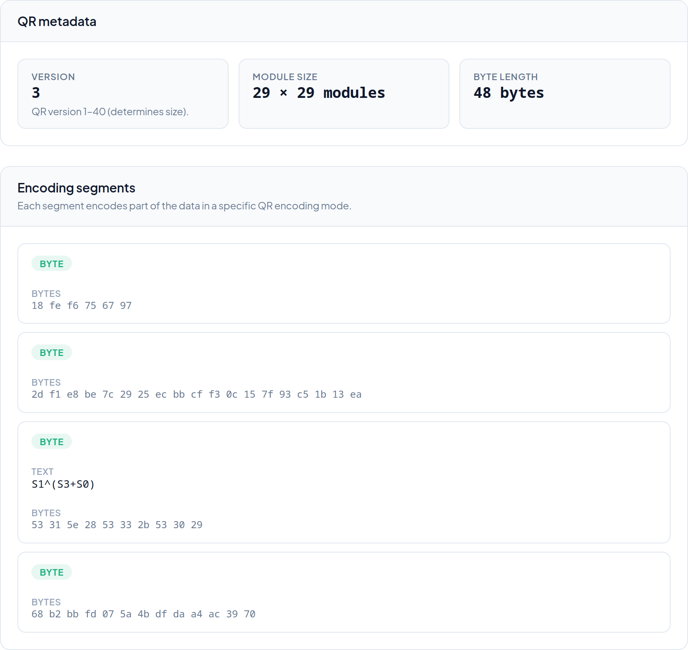

## Solution

To begin with, scanning the QR code with different scanners may or may not produce something useful. Depending on the implementation, the scan might:

* not work,
* produce the string `S1^(S3+S0)`, or
* produce the string `S1^(S3+S0)` surrounded by garbled characters.

An oddity about the code is that it is a version 3 QR code (29 x 29 modules), which should allow 42 bytes of data, but the string above only contains 10 bytes, for which the much smaller version 1 would suffice.

We can take a better look at the QR code with a more debug-focused scanner implementation, or using a library.

### Debugger scanner

Most implementations you find by looking for "qr reader online" or similar are going to result in the second output mentioned above, i.e., only the text will be shown. Looking for "qr code debugger" resulted in one implementation that was actually useful though: [short.io](https://short.io/tools/qr-code-debugger), which analyses the given QR code as such:



### Library

Alternatively, we can use a QR reader library. With many libraries, including the popular zxing, we can at least get the raw bytes stored in the QR code, although most libraries consider a QR code to be just a container of bytes, ignoring the actual composition of the code. (In zxing, there seems to be [a way](https://zxing.github.io/zxing/apidocs/com/google/zxing/common/DecoderResult.html#getByteSegments()) to get the byte segments of a code.) With a QR-specific library, such as [`jsqr`](https://www.npmjs.com/package/jsqr), the segments are also accessible:

```js
import jsQR from "jsqr";
import { getSync } from '@andreekeberg/imagedata';
const data = getSync("../public/output.png");
const decoded = jsQR(data.data, 512, 512);
console.log(decoded);
```

```text
$ node index.js 
{
  binaryData: [
     24, 254, 246, 117, 103, 151,  45, 241, 232, 190,
    124,  41,  37, 236, 187, 207, 243,  12,  21, 127,
    147, 197,  27,  19, 234,  83,  49,  94,  40,  83,
     51,  43,  83,  48,  41, 104, 178, 187, 253,   7,
     90,  75, 223, 218, 164, 172,  57, 112
  ],
  data: 'S1^(S3+S0)',
  chunks: [
    { type: 'byte', bytes: [Array], text: '' },
    { type: 'byte', bytes: [Array], text: '' },
    { type: 'byte', bytes: [Array], text: 'S1^(S3+S0)' },
    { type: 'byte', bytes: [Array], text: '' }
  ],
  version: 3,
  location: { ... }
}
```

```js
console.log(decoded.chunks[0].bytes);
console.log(decoded.chunks[1].bytes);
console.log(decoded.chunks[2].bytes);
console.log(decoded.chunks[3].bytes);
```

```text
[ 24, 254, 246, 117, 103, 151 ]
[ 45, 241, 232, 190, 124, 41, 37, 236, 187, 207, 243, 12, 21, 127, 147, 197, 27, 19, 234 ]
[ 83, 49, 94, 40, 83, 51, 43, 83, 48, 41 ]
[ 104, 178, 187, 253, 7, 90,75, 223, 218, 164, 172, 57, 112 ]
```

### Getting the flag

So we got four segments, three of which seem like garbled binary data, and the third which is the string `S1^(S3+S0)`. If we assume the segments are numbered `S0`, `S1`, `S2`, and `S3`, we can obtain the flag by the suggested concatenation + XOR operation:

```js
const S0 = decoded.chunks[0].bytes;
const S1 = decoded.chunks[1].bytes;
const S2 = decoded.chunks[2].bytes;
const S3 = decoded.chunks[3].bytes;
const S3S0 = new Array(...S3, ...S0);

let output = new Array(S1.length);
for (let i = 0; i < S1.length; i++) {
    output[i] = S1[i] ^ S3S0[i];
}
console.log(Buffer.from(output).toString());
```

```text
ECSC{sn3ak_5egm3nt}
```
