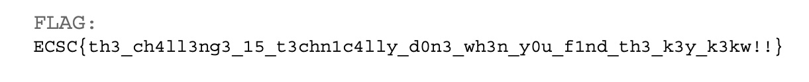

# ECSC 2026 - Cache me if you can

## Enumeration

We are given a zip containing 2 files:

- `memory.elf`
- `b_disk.img` - `b_disk.img: bcachefs, UUID=3f730749-d766-4785-bb68-d8b64ce71efe, version 1062, min version 1062, device 0, 1 devices`

We have a `bcachefs` disk image, and a memory dump. Let's inspect the `superblock` information of that partition:

```bash
$ bcachefs show-super b_disk.img

WARNING: kernel does not have CONFIG_RUST enabled; this will be required for bcachefs in the near future
         please alert your distribution or kernel developers if your kernel does not support CONFIG_RUST
Enter passphrase:
error requesting encryption key: Required key not available
error starting filesystem: Required key not available
Error: Required key not available
```

The superblock bytes are not actually encrypted, but `bcachefs` tries to unlock the whole device. In any case, we can see the device is encrypted. Before looking for a way to decrypt the partition, we first have to understand how `bcachefs` goes from passphrase -> `ChaCha20`.

> [!NOTE]
> The challenge was conceived with `bcachefs` in mind because of `ChaCha20` => Immune to `aeskeyfind` AES scheduling identification!

### Bcachefs Encryption Primer


The steps pertaining to this challenge are:

1. Passphrase is read and seeds a KDF which derives a KEY: `Passphrase Key`
2. `Passphrase Key` is stored in the Kernel Keyring
3. `Passphrase Key` is used to encrypt the Master Key (`ChaCha20` key), which is generated during `bcachefs --format`. The Master Key is stored encrypted in the `super_block` _ON_ disk!
4. On decryption, the Master Key is stored in `bch_fs.chacha20_key`.

We have 3 equivalent values, any one of which is necessary and sufficient to solve the challenge!

> [!TIP]
> While all 3 values are sufficient, some of them are easier to work with and require much, _much_ less work to _be_ sufficient. We'll explore this later on!


### Volatility ISF

In order to use volatility with this image, we have to create symbols for it — or, since this is an Ubuntu image (_and not a made-up custom kernel..._), we could try using [AbyssW4tcher's repository](https://github.com/Abyss-W4tcher/volatility3-symbols), which contains ISFs for popular distros.

```bash
$ vol -f memory.elf banners
Volatility 3 Framework 2.28.3
Progress:  100.00               PDB scanning finished
Offset  Banner

0x53a000e0      Linux version 7.0.0-28-generic (buildd@lcy02-amd64-047) (x86_64-linux-gnu-gcc (Ubuntu 15.2.0-16ubuntu1) 15.2.0, GNU ld (GNU Binutils for Ubuntu) 2.46) #28-Ubuntu SMP PREEMPT_DYNAMIC  (Ubuntu 7.0.0-28.28-generic 7.0.12)
0x53bce580      Linux version 7.0.0-28-generic (buildd@lcy02-amd64-047) (x86_64-linux-gnu-gcc (Ubuntu 15.2.0-16ubuntu1) 15.2.0, GNU ld (GNU Binutils for Ubuntu) 2.46) #28-Ubuntu SMP PREEMPT_DYNAMIC Sun Jun 21 01:01:36 UTC 2026 (Ubuntu 7.0.0-28.28-generic 7.0.12)
0x556b37e0      Linux version 7.0.0-28-generic (buildd@lcy02-amd64-047) (x86_64-linux-gnu-gcc (Ubuntu 15.2.0-16ubuntu1) 15.2.0, GNU ld (GNU Binutils for Ubuntu) 2.46) #28-Ubuntu SMP PREEMPT_DYNAMIC Sun Jun 21 01:01:36 UTC 2026 (Ubuntu 7.0.0-28.28-generic 7.0.12)2)
0x80b5b8a8      Linux version 7.0.0-28-generic (buildd@lcy02-amd64-047) (x86_64-linux-gnu-gcc (Ubuntu 15.2.0-16ubuntu1) 15.2.0, GNU ld (GNU Binutils for Ubuntu) 2.46) #28-Ubuntu SMP PREEMPT_DYNAMIC Sun Jun 21 01:01:36 UTC 2026 (Ubuntu 7.0.0-28.28-generic 7.0.12)

$ vol --remote-isf-url 'https://github.com/Abyss-W4tcher/volatility3-symbols/raw/master/banners/banners.json' -f memory.elf linux.pslist

Volatility 3 Framework 2.28.3
Progress:  100.00               Stacking attempts finished
OFFSET (V)      PID     TID     PPID    COMM    UID     GID     EUID    EGID    CREATION TIME   File output

0x88f2408baa80  1       1       0       systemd 0       0       0       0       2026-07-28 15:43:33.311888 UTC  Disabled
0x88f2408b2a80  2       2       0       kthreadd        0       0       0       0       2026-07-28 15:43:33.311888 UTC  Disabled
0x88f2408b0000  3       3       2       pool_workqueue_ 0       0       0       0       2026-07-28 15:43:33.413888 UTC  Disabled
0x88f2408b5500  4       4       2       kworker/R-rcu_g 0       0       0       0       2026-07-28 15:43:33.413888 UTC  Disabled
0x88f2408ed500  5       5       2       kworker/R-sync_ 0       0       0       0       2026-07-28 15:43:33.413888 UTC  Disabled
0x88f2408eaa80  6       6       2       kworker/R-kvfre 0       0       0       0       2026-07-28 15:43:33.413888 UTC  Disabled
[...]
```

> [!NOTE]
> If you wanted to manually create ISFs you could follow [my guide](https://www.hackthebox.com/blog/how-to-create-linux-symbol-tables-volatility) over at Hack The Box's Blog

> [!TIP]
> Volatility caches the matched symbol file, so subsequent invocations don't need the `--remote-isf-url`

### The Mount Chronicle

Let's explore the Bash history:

```bash
vol -f memory.elf linux.bash
Volatility 3 Framework 2.28.3
Progress:  100.00               Stacking attempts finished
PID     Process CommandTime     Command

4536    bash    2026-07-28 15:44:03.000000 UTC  bcachefs image create -h
4536    bash    2026-07-28 15:44:03.000000 UTC  ls
4536    bash    2026-07-28 15:44:03.000000 UTC  cd /mnt/
4536    bash    2026-07-28 15:44:03.000000 UTC  sudo apt install neovim
4536    bash    2026-07-28 15:44:03.000000 UTC  sudo nvim /etc/default/grub
4536    bash    2026-07-28 15:44:03.000000 UTC  bcachefs version
4536    bash    2026-07-28 15:44:03.000000 UTC  bcachefs -h
4536    bash    2026-07-28 15:44:03.000000 UTC  sudo vim /etc/default/grub
4536    bash    2026-07-28 15:44:15.000000 UTC  sudo su

4536    bash    2026-07-28 15:45:06.000000 UTC  ls
4536    bash    2026-07-28 15:45:08.000000 UTC  ls -lah
4536    bash    2026-07-28 15:45:17.000000 UTC  sudo chown user:user b_disk.img
4536    bash    2026-07-28 15:45:19.000000 UTC  clear
4536    bash    2026-07-28 15:45:51.000000 UTC  sudo bcachefs unlock -k session -f /run/media/user/dev_usb/passphrase.txt b_disk.img

4536    bash    2026-07-28 15:46:09.000000 UTC  sudo mount -t bcachefs b_disk.img /mnt
4536    bash    2026-07-28 15:46:13.000000 UTC  mount

4536    bash    2026-07-28 15:47:08.000000 UTC  keyctl list
4536    bash    2026-07-28 15:47:12.000000 UTC  sudo apt install keyutils
4536    bash    2026-07-28 15:47:17.000000 UTC  keyctl list
4536    bash    2026-07-28 15:47:20.000000 UTC  keyctl list @s
4536    bash    2026-07-28 15:47:31.000000 UTC  keyctl unlink 566656059 @s

4536    bash    2026-07-28 15:48:55.000000 UTC  keyctl show @s
4536    bash    2026-07-28 15:49:14.000000 UTC  keyctl revoke 566656059 @s
4536    bash    2026-07-28 15:49:26.000000 UTC  keyctl revoke 566656059
4536    bash    2026-07-28 15:49:46.000000 UTC  sudo sd-mem
4536    bash    2026-07-28 15:49:49.000000 UTC  sdmem

5342    bash    2026-07-28 15:48:30.000000 UTC  exit
5342    bash    2026-07-28 15:48:30.000000 UTC  chown user:user /run/media/user/dev_usb/passphrase.txt
5342    bash    2026-07-28 15:48:30.000000 UTC  cp passphrase.txt /run/media/user/dev_usb/
5342    bash    2026-07-28 15:48:30.000000 UTC  cp b_disk.img /home/user/
```

While not the best timings to create a proper timeline of the events, the key takeaways from this are:

- Passphrase was a txt document, not typed
- Said passphrase lives in a _removable_ USB!
- **Passphrase Key** has been ~~in~~conveniently revoked from the keyring!
- There was a pass with `sdmem` to wipe stale memory values!

While we are at it, let's also dump (a list of) the cached files. (The challenge is marked as `Hard` so it's unlikely the intended path is to use `passphrase.txt`):

```bash
$ rg -i "pass" memfiles
1536:0x88f241742800     /       8:2     526733  0x88f1430bb5f0  REG     1       1       -rw-r--r--      2026-07-28 13:49:10.000000 UTC  2026-07-28 13:49:10.000000 UTC  2026-07-28 13:49:10.000000 UTC  /etc/passwd     2811
2590:0x88f2417e1800     /run    0:28    932     0x88f24a2cd298  SOCK    0       0       srw-rw-rw-      2026-07-28 15:43:38.000000 UTC  2026-07-28 15:43:38.000000 UTC  2026-07-28 15:43:38.000000 UTC  /run/systemd/io.systemd.AskPassword     0
2720:0x88f2417e1800     /run    0:28    46      0x88f2487cd298  DIR     1       0       drwxr-xr-x      2026-07-28 15:48:54.000000 UTC  2026-07-28 15:43:34.000000 UTC  2026-07-28 15:43:34.000000 UTC  /run/systemd/ask-password       40
9761:0x88f240826000     /sys/kernel/debug       0:9     14      0x88f24049a290  REG     0       0       -r--r--r--      2026-07-28 15:43:36.000000 UTC  2026-07-28 15:43:36.000000 UTC  2026-07-28 15:43:36.000000 UTC  /sys/kernel/debug/regulator/reg-dummy-regulator-dummy/bypass_count     0
9865:0x88f24871c800     /snap/core24/1587       7:1     7590    0x88f1420c7480  DIR     1       0       drwxr-xr-x      2026-03-17 03:54:23.000000 UTC  2026-03-17 03:54:23.000000 UTC  2026-03-17 03:54:23.000000 UTC  /snap/core24/1587/usr/share/base-passwd56
11236:0x88f24947e800    /run/user/1000  0:86    63      0x88f146c84c98  SOCK    0       0       srw-------      2026-07-28 15:43:55.000000 UTC  2026-07-28 15:43:55.000000 UTC  2026-07-28 15:43:55.000000 UTC  /run/user/1000/systemd/io.systemd.AskPassword 0
11387:0x88f141150000    /snap/core24/1643       7:13    7586    0x88f1419d3cc0  DIR     1       0       drwxr-xr-x      2026-04-10 04:18:08.000000 UTC  2026-04-10 04:18:08.000000 UTC  2026-04-10 04:18:08.000000 UTC  /snap/core24/1643/usr/share/base-passwd56
11629:0x88f156a54000    /run/user/0     0:58    60      0x88f21dfd0398  SOCK    0       0       srw-------      2026-07-28 15:48:30.000000 UTC  2026-07-28 15:48:30.000000 UTC  2026-07-28 15:48:30.000000 UTC  /run/user/0/systemd/io.systemd.AskPassword    0
12355:0x88f141155000    /usr/share      0:68    4       0x88f142503c98  DIR     1       0       drwxr-xr-x      2026-07-28 15:43:42.000000 UTC  2026-07-28 15:43:42.000000 UTC  2026-07-28 15:43:42.000000 UTC  /usr/share/base-passwd  40

$ rg -i "dev_usb" memfiles
1918:0x88f2417e1800     /run    0:28    1288    0x88f24ab08098  DIR     1       0       drwxr-xr-x      2026-07-28 15:43:39.000000 UTC  2026-07-28 15:43:39.000000 UTC  2026-07-28 15:43:39.000000 UTC  /run/udev/links/disk\x2fby-label\x2fdev_usb     60
1919:0x88f2417e1800     /run    0:28    1289    0x88f24ab0a798  LNK     1       0       lrwxrwxrwx      2026-07-28 15:46:20.000000 UTC  2026-07-28 15:43:39.000000 UTC  2026-07-28 15:43:39.000000 UTC  /run/udev/links/disk\x2fby-label\x2fdev_usb/b8:16 -> 0:/dev/sdb        10
2964:0x88f240826800     /dev    0:7     597     0x88f24ab0b998  LNK     1       0       lrwxrwxrwx      2026-07-28 15:48:56.000000 UTC  2026-07-28 15:43:39.000000 UTC  2026-07-28 15:43:39.000000 UTC  /dev/disk/by-label/dev_usb -> ../../sdb 9
```

Nothing... And for good measure, let's check the kernel cmdline: the user did edit the `/etc/default/grub` file. Instead of dumping the `grub` config file, let's read the cmdline from the kernel directly using `volshell`:

```python
[layer_name]> from volatility3.framework.objects import utility
[layer_name]> vmlinux = self.context.modules[self.config['kernel']]
Out[5]: <volatility3.framework.contexts.Module at 0x10a99b9d0>
[layer_name]> saved_command_line = vmlinux.object_from_symbol("saved_command_line")
[layer_name]> dt(saved_command_line)
symbol_table_name1!pointer (8 bytes) @ 0xffffbd858028 -> 0x88f25ffc9080
     symbol_table_name1!char (1 bytes): 66
[layer_name]> vmlinux.has_symbol("saved_command_line_len")
Out[8]: True
[layer_name]> n = vmlinux.object_from_symbol("saved_command_line_len")
[layer_name]> cmdline = utility.pointer_to_string(saved_command_line, n+1)
[layer_name]> cmdline
Out[13]: 'BOOT_IMAGE=/boot/vmlinuz-7.0.0-28-generic root=UUID=88469ccf-cada-49c0-a4f1-074a4fadc795 ro quiet splash init_on_free=1 crashkernel=2G-4G:320M,4G-32G:512M,32G-64G:1024M,64G-128G:2048M,128G-:4096M'
```

In the words of `hlt`: "That `init_on_free=1`... diabolical..."

`init_on_free=1` will instruct the kernel to initialize every freed memory location, albeit not immediately, but following up with `sdmem` makes it safe to assume that _no stale memory values exist_.

It's clear that ~~me~~ the author wants us to recover the Master Key from within `bcachefs`'s kernel structures, rather than recovering the passphrase, or reading the key from the keyring.

## Bcachefs

Let's go back to step 5 of unlocking, and into the `bch2_decrypt_sb_key()` function:

**`fs/bcachefs/data/checksum.c`**
```c
int bch2_decrypt_sb_key(struct bch_fs *c,
			struct bch_sb_field_crypt *crypt,
			struct bch_key *key)
{
	struct bch_encrypted_key sb_key = crypt->key;
	struct bch_key user_key;
	int ret = 0;

	/* is key encrypted? */
	if (!bch2_key_is_encrypted(&sb_key))
		goto out;

	ret = bch2_request_key(c->disk_sb.sb, &user_key);
	if (ret) {
		bch_err(c, "error requesting encryption key: %s", bch2_err_str(ret));
		goto err;
	}

	/* decrypt real key: */
	bch2_chacha20(&user_key, bch2_sb_key_nonce(c), &sb_key, sizeof(sb_key));

	if (bch2_key_is_encrypted(&sb_key)) {
		bch_err(c, "incorrect encryption key");
		ret = -EINVAL;
		goto err;
	}
out:
	*key = sb_key.key;
err:
	memzero_explicit(&sb_key, sizeof(sb_key));
	memzero_explicit(&user_key, sizeof(user_key));
	return ret;
}

int bch2_fs_encryption_init(struct bch_fs *c)
{
	struct bch_sb_field_crypt *crypt = bch2_sb_field_get(c->disk_sb.sb, crypt);
	if (!crypt)
		return 0;

	try(bch2_decrypt_sb_key(c, crypt, &c->chacha20_key));

	c->chacha20_key_set = true;
	return 0;
}
```

> [!NOTE]
> Above code is tagged v1.38.8

The driver passes a pointer to `bch_fs` (`c`), and also a pointer to its field `chacha20_key` to the `bch2_decrypt_sb_key()` function. In turn, the function requests the passphrase from the user, derives the `Passphrase Key` and decrypts and stores the Master Key under `bch_fs.chacha20_key`.

This is our destination structure, from which we would need to grab the key!

Instead of correlating and subtracting offsets, we will directly interface with the structure in `volshell`. The `bch_fs` structure is **massive**, 600KB for a single struct; it's paramount that we are working with the correct structure layout, since a single byte off would render our approach useless.

<<<<<<< Updated upstream
The kernel module on the VM is version 1.38.X, so we should use the latest release of that Minor Version:
`1.38.8`: `bcachefs-kernel-dkms_1.38.8_amd64.deb`

=======
We will create debug symbols for the `bcachefs.ko` module from **the same DKMS** source that was used on the Ubuntu VM we have the memory snapshot of! That way we can have a concrete anchor without the need for a _leak_ (Hear that Trixter, no guessing :*)
>>>>>>> Stashed changes

### Creating Intermediate Symbol Files

#### Finding bcachefs Version

Firstly, we dump the `bcachefs` kernel module from memory:

```bash
$ vol -f memory.elf linux.lsmod [--dump]
Volatility 3 Framework 2.28.3
Progress:  100.00               Stacking attempts finished
Offset  Module Name     Code Size       Taints  Load Arguments  File Output

0xffffc077b380  bcachefs        0x30a000        OOT_MODULE,UNSIGNED_MODULE      mm_avoid_compaction=None, verify_compress=None, poison_extents_on_checksum_error=None, version=None, debug_check_bkey_unpack=None, debug_check_btree_accounting=None, debug_check_bset_lookups=None, debug_check_iterators=None, debug_check_btree_locking=None, backpointers_no_use_write_buffer=None, btree_shrinker_disabled=None, btree_gc_rewrite_disabled=None, btree_gc_always_rewrite=None, btree_node_merging_disabled=None, key_merging_disabled=None       N/A
```

Bcachefs stores metadata version information for every version starting from 1.0 - major_minor:

```bash
$ strings -a bcachefs_ext.ko | awk '/^major_minor$/{f=1;n=0} f{print "1." n++ "\t" $0} /^need_discard_by_journal_seq$/{exit}'
1.0     major_minor
1.1     snapshot_skiplists
1.2     deleted_inodes
1.3     rebalance_work
1.4     member_seq
1.5     subvolume_fs_parent
1.6     btree_subvolume_children
1.7     mi_btree_bitmap
1.8     bucket_stripe_sectors
1.9     disk_accounting_v2
1.10    disk_accounting_v3
1.11    disk_accounting_inum
1.12    rebalance_work_acct_fix
1.13    inode_has_child_snapshots
1.14    backpointer_bucket_gen
1.15    disk_accounting_big_endian
1.16    reflink_p_may_update_opts
1.17    inode_depth
1.18    persistent_inode_cursors
1.19    autofix_errors
1.20    directory_size
1.21    cached_backpointers
1.22    stripe_backpointers
1.23    stripe_lru
1.24    casefolding
1.25    extent_flags
1.26    snapshot_deletion_v2
1.27    fast_device_removal
1.28    inode_has_case_insensitive
1.29    extent_snapshot_whiteouts
1.30    31bit_dirent_offset
1.31    btree_node_accounting
1.32    sb_field_extent_type_u64s
1.33    reconcile
1.34    extented_key_type_error
1.35    bucket_stripe_index
1.36    no_sb_user_data_replicas
1.37    erasure_coding
1.38    need_discard_by_journal_seq
```

Also, we could use `ID_FS_VERSION` from the disk directly:

```bash
$ blkid -p -o udev b_disk.img | grep ID_FS_VERSION
ID_FS_VERSION=1.38
```

So we need to download the [DKMS releases](https://apt.bcachefs.org/resolute/pool/main/b/bcachefs-tools/) for Ubuntu 26.04 LTS, "Resolute Raccoon". The latest 1.38 release is what we want: `bcachefs-kernel-dkms_1.38.8_amd64.deb`

```bash
$ pwd
bcachefs-dkms/usr/src/bcachefs-1.38.8
$ ls
Makefile  build.vars  dkms.conf  src/
```

We have to change the following line in the `Makefile` in order to add debug information:

```diff
--- a/dkms/Makefile
+++ b/dkms/Makefile
@@ -1,22 +1,23 @@
 export BCACHEFS_DKMS=1
 
 # Pick up build options written by `make install_dkms` (e.g.
 # BCACHEFS_DEBUG, BCACHEFS_TESTS). Whichever of these names the included
 # file defines flow through to the recursive kbuild and trip the matching
 # ifdefs in fs/Makefile. Empty / missing file is fine - unset names
 # export as no-ops.
 -include $(CURDIR)/build.vars
 export BCACHEFS_DEBUG BCACHEFS_TESTS BCACHEFS_INJECT_TRANSACTION_RESTARTS BCACHEFS_RUST
 
 ifneq (${KERNELRELEASE},)
-ccflags-y := -I$(src)/include
+ccflags-y := -I$(src)/include -g -gdwarf-5
 obj-m += src/fs/bcachefs/
 else
 KDIR ?= /lib/modules/`uname -r`/build
 
 default:
 	$(MAKE) -C $(KDIR) M=$$PWD modules
 
 clean:
 	$(MAKE) -C $(KDIR) M=$$PWD clean
 endif
```

And we can use something like the following script to cross-build on any system, without having to create a matching Ubuntu VM:

```bash
#!/usr/bin/env bash
# Build the bcachefs DKMS module against an already-extracted kernel headers
# tree, with DWARF debug info forced by the module Makefile regardless of the
# target kernel's own CONFIG_DEBUG_INFO setting.
#
# Usage:
#   build-bcachefs-for-kernel.sh <bcachefs-dir> <headers-dir>
#
# <bcachefs-dir>  path to the bcachefs DKMS source (contains Makefile, src/)
# <headers-dir>   path to the extracted linux-headers tree (contains .config,
#                 scripts/, etc.)
set -euo pipefail

MOD_SRC="$(cd "${1:?usage: $0 <bcachefs-dir> <headers-dir>}" && pwd)"
KDIR="$(cd "${2:?usage: $0 <bcachefs-dir> <headers-dir>}" && pwd)"

if [ ! -f "$KDIR/.config" ]; then
  echo "error: no .config found in $KDIR" >&2
  exit 1
fi
if [ ! -f "$KDIR/scripts/Kbuild.include" ]; then
  echo "error: $KDIR is missing scripts/" >&2
  exit 1
fi

echo "== building bcachefs.ko against $KDIR =="
make -C "$MOD_SRC" KDIR="$KDIR" clean >/dev/null 2>&1 || true
make -C "$MOD_SRC" KDIR="$KDIR"

KO="$MOD_SRC/src/fs/bcachefs/bcachefs.ko"
echo
echo "== result =="
file "$KO"
echo "vermagic: $(modinfo -F vermagic "$KO" 2>/dev/null)"
```

After building, we can just use `dwarf2json` to extract a `json` file containing the proper symbol information we can insert into `volshell`!

```bash
$ dwarf2json linux --elf bcachefs.ko > syms/bcachefs.json
$ head bcachefs.json
{
  "metadata": {
    "linux": {
      "symbols": [
        {
          "kind": "dwarf",
          "name": "bcachefs.ko",
          "hash_type": "sha256",
          "hash_value": "dd6c5da1e48ea0daf6071a0cf0198956de48d5e07492832cdef40ead3763df04"
        },
```

We can add additional symbol paths for volatility to search through using `-s`, so we run `volshell` again with `-s syms`. We begin by importing some needed modules and grabbing the kernel module and layer:

### Retrieving the Key
#### The superblock hunt

```python
[layer_name]> from volatility3.framework.symbols import intermed, linux

[layer_name]> vmlinux = self.context.modules[self.config['kernel']]
[layer_name]> kernel_layer = self.context.layers['layer_name']
```

We then iterate over the list of superblocks until we arrive at the `bcachefs` one:

```python
[layer_name]> super_blocks = vmlinux.object_from_symbol("super_blocks")

[layer_name]> dt(super_blocks)
symbol_table_name1!list_head (16 bytes) @ 0xffffbe4ac1f0:
  0x0 :   next     *symbol_table_name1!list_head     0x88f240823000
  0x8 :   prev     *symbol_table_name1!list_head     0x88f141152800

[layer_name]> super_block_list = list(
  super_blocks.to_list(
    symbol_type=f"{vmlinux.symbol_table_name}!super_block", 
    member="s_list"
  )
)

[layer_name]> sb_bch = None

[layer_name]> for sb in super_block_list:
         ...:     sb_name = sb.get_type()
         ...:     if sb_name == "bcachefs":
         ...:         sb_bch = sb
         ...:
```

When the loop finishes, we should have an object of type `super_block`:

```python
[layer_name]> dt(sb_bch)
symbol_table_name1!super_block (1408 bytes) @ 0x88f242762000:
    0x0 :   s_list                    symbol_table_name1!list_head                offset: 0x88f242762000
   0x10 :   s_dev                     symbol_table_name1!unsigned int             7340044
   0x14 :   s_blocksize_bits          symbol_table_name1!unsigned char            12
   0x18 :   s_blocksize               symbol_table_name1!long unsigned int        4096
   0x20 :   s_maxbytes                symbol_table_name1!long long int            9223372036854775807
   0x28 :   s_type                    *symbol_table_name1!file_system_type        0xffffc0775560
   0x30 :   s_op                      *symbol_table_name1!super_operations        0xffffc0a0ff80
   0x38 :   dq_op                     *symbol_table_name1!dquot_operations        0x0 (null pointer)
   [...]

[layer_name]> sb_bch.uuid
Out[11]: '3f730749-d766-4785-bb68-d8b64ce71efe'
```

The `UUID` matches the one provided by the `file` command as well!

The `super_block` struct contains an attribute named `s_fs_info` which points to each filesystem's private information; this points to `bch_fs` and is the reason why we needed to create an ISF for `bcachefs`.

#### Volshell with custom ISFs

```python
[layer_name]> bch_table_name = intermed.IntermediateSymbolTable.create(
         ...:     context=self.context,
         ...:     config_path="symbols.bcachefs",
         ...:     sub_path="",
         ...:     filename="bcachefs",
         ...: )

[layer_name]> bch_table_name
Out[13]: 'bcachefs1'
```

We can add the symbol file we created earlier with `filename=bcachefs[.json]` (ignoring the extension). `sub_path` needs to be empty because we added the `syms` directory in the global symbol search path!

When we have the table name, we can use it to instantiate objects of that table at arbitrary locations!

```python
[layer_name]> bch_fs = self.context.object(
         ...:     object_type=f"{bch_table_name}!bch_fs",
         ...:     offset=sb_bch.s_fs_info,
         ...:     layer_name="layer_name"
         ...:     )

[layer_name]> dt(bch_fs)
bcachefs1!bch_fs (559488 bytes) @ 0x88f156400000:
      0x0 :   cl                                 bcachefs1!closure                          offset: 0x88f156400000
     0x30 :   list                               bcachefs1!list_head                        offset: 0x88f156400030
     [...]
```

Lo and behold, the 600KB `bch_fs` struct!

From here, we can directly read the `chacha20_key`:

```python
[layer_name]> chacha20_key = kernel_layer.read(bch_fs.chacha20_key.vol.offset, 32)
[layer_name]> chacha20_key.hex()
Out[22]: '853ed0ebcb874dc4f04bd310d4d97e3af2a401354f77fa8c07ea60c7b5458133'
```

Unfortunately we cannot check for the `bch**key` Magic, since we don't have the `Passphrase Key`...

## Sufficient conditions

Assuming the Master Key we recovered earlier is correct, we cannot use it directly as we would do for example in a BitLocker/LUKS volume... The mounting chain goes through the passphrase mechanism... We can counteract this in one of 2 ways:

1. The Master Key is stored encrypted by the `Passphrase Key` (=== Passphrase). We can re-encrypt the Master Key with our own passphrase-derived key and replace it in the partition. This, however, would entail that we also replace it in *every* copy of the superblock across the disk image *AND* recalculate the appropriate CRC32 checksums to go with them!
2. Hardcode the Master Key in the driver itself so it always uses our key, regardless of passphrase, and never asks for a passphrase at all.

For a CTF that banned LLMs the simplest solution is the 2nd. But just for good measure ~~I~~ Claude slopped a script that will perform method 1.

### Modifying the source

```diff
--- a/fs/data/checksum.c
+++ b/fs/data/checksum.c
@@ -1,11 +1,12 @@
 int bch2_fs_encryption_init(struct bch_fs *c)
 {
 	struct bch_sb_field_crypt *crypt = bch2_sb_field_get(c->disk_sb.sb, crypt);
 	if (!crypt)
 		return 0;
 
-	try(bch2_decrypt_sb_key(c, crypt, &c->chacha20_key));
+	//try(bch2_decrypt_sb_key(c, crypt, &c->chacha20_key));
+	char hardcode_key[32] = {0x85,0x3e,0xd0,0xeb,0xcb,0x87,0x4d,0xc4,0xf0,0x4b,0xd3,0x10,0xd4,0xd9,0x7e,0x3a,0xf2,0xa4,0x01,0x35,0x4f,0x77,0xfa,0x8c,0x07,0xea,0x60,0xc7,0xb5,0x45,0x81,0x33};
+	memcpy(c->chacha20_key.key, hardcode_key, 32);
 	c->chacha20_key_set = true;
 	return 0;
 }
```

We force the driver to hardcode the key into the `bch_fs` structure and never even bother calling `bch2_decrypt_sb_key()`, which in turn asks for the passphrase, etc:

**`fs/bcachefs/data/checksum.c`**
```c
int bch2_request_key(struct bch_sb *sb, struct bch_key *key)
{
	CLASS(printbuf, key_description)();
	int ret;

	prt_printf(&key_description, "bcachefs:");
	pr_uuid(&key_description, sb->user_uuid.b);

	ret = __bch2_request_key(key_description.buf, key);

#ifndef __KERNEL__
	if (ret) {
		char *passphrase = read_passphrase("Enter passphrase: ");
		struct bch_encrypted_key sb_key;

		bch2_passphrase_check(sb, passphrase,
				      key, &sb_key);
		ret = 0;
	}
#endif

	/* stash with memfd, pass memfd fd to mount */

	return ret;
}
```

From here we could build from the git source on any distro we want (should check out tag 1.38.8) or we could download and modify the DKMS source on Ubuntu 26.04.

### Building

We clone the official git repo and check out `v1.38.8`:

```bash
$ git clone https://github.com/koverstreet/bcachefs-tools.git
$ git fetch --tags
$ git checkout tags/v1.38.8
```

We build using `make` and install the module with `sudo make dkms-reload`:

```bash
$ sudo make dkms-reload
make[1]: Entering directory '/home/canopus/dev/bcachefs-tools'
    [SED]    dkms/dkms.conf
install -m0644 -D dkms/Makefile         -t /usr/src/bcachefs-v1.38.8-dirty
install -m0644 -D dkms/dkms.conf                -t /usr/src/bcachefs-v1.38.8-dirty
install -m0644 -D fs/Makefile   -t /usr/src/bcachefs-v1.38.8-dirty/src/fs/bcachefs
(cd fs; find . -path ./vendor/kernel-rust -prune -o \( -name '*.[ch]' -o -name '*.rs' \) -exec install -m0644 -D {} /usr/src/bcachefs-v1.38.8-dirty/src/fs/bcachefs/{} \; )
mkdir -p /usr/src/bcachefs-v1.38.8-dirty/src/fs/bcachefs/vendor
cp -a fs/vendor/kernel-rust /usr/src/bcachefs-v1.38.8-dirty/src/fs/bcachefs/vendor/
install -m0755 -D fs/scripts/getdents-layout.sh -t /usr/src/bcachefs-v1.38.8-dirty/src/fs/bcachefs/scripts
install -m0755 -D fs/scripts/rust-is-available-dkms.sh -t /usr/src/bcachefs-v1.38.8-dirty/src/fs/bcachefs/scripts
install -m0755 -D fs/scripts/fetch-module.sh -t /usr/src/bcachefs-v1.38.8-dirty/src/fs/bcachefs/scripts
install -m0644 -D signing/bcachefs-signing-ca.pem -t /usr/src/bcachefs-v1.38.8-dirty/src/fs/bcachefs/scripts
install -m0644 -D dkms/module-version.c -t /usr/src/bcachefs-v1.38.8-dirty/src/fs/bcachefs
install -m0644 -D version.h                     -t /usr/src/bcachefs-v1.38.8-dirty/src/fs/bcachefs
make[1]: Leaving directory '/home/canopus/dev/bcachefs-tools'
    [DKMS]   bcachefs/v1.38.8-dirty

Deleting module bcachefs/v1.38.8-dirty completely from the DKMS tree.
Creating symlink /var/lib/dkms/bcachefs/v1.38.8-dirty/source -> /usr/src/bcachefs-v1.38.8-dirty
Sign command: /usr/lib/modules/7.2.9-1-cachyos/build/scripts/sign-file
Signing key: /var/lib/dkms/mok.key
Public certificate (MOK): /var/lib/dkms/mok.pub

Building module(s).............. done.
Signing module /var/lib/dkms/bcachefs/v1.38.8-dirty/build/src/fs/bcachefs/bcachefs.ko
Installing /usr/lib/modules/7.2.9-1-cachyos/updates/dkms/bcachefs.ko.zst
Running depmod... done.
filename:       /lib/modules/7.2.9-1-cachyos/updates/dkms/bcachefs.ko.zst
version:        v1.38.8-dirty
srcversion:     5EF4FF48F1CBA6B95A7621C

$ lsmod | rg bcache
bcachefs             3162112  0
lz4hc_compress         20480  2 zram,bcachefs
```

Finally, we can mount as normal and browse the mount for files:

```bash
$ sudo mount -t bcachefs b_disk.img /mnt
[sudo] password for canopus:
$ ls /mnt
drwx------   - root root 28 Jul 17:21  lost+found
.rw-r--r-- 72k root root 28 Jul 17:21  'Kuchenblech Mafia Research Report.pdf'
```

Agh, the Kuchenblech Mafia strikes again!



> [!WARNING]
> The FUSE mount path has a bug that requires this fix on `1.38.8`. Unrelated to the Key hardcoding:
> ```diff
> diff --git a/fs/fs/dirent.c b/fs/fs/dirent.c
> index 45960b0d9..971163d6c 100644
> --- a/fs/fs/dirent.c
> +++ b/fs/fs/dirent.c
> @@ -784,6 +784,8 @@ static int bch2_dir_emit(struct btree_trans *trans,
>                          struct dir_context *ctx,
>                          struct bkey_s_c_dirent d, subvol_inum target)
>  {
> +       /* FUSE: actor derives the entry offset from ctx->pos (see kernel variant) */
> +       ctx->pos = d.k->p.offset;
>         return bch2_dir_emit_slow(trans, sk, ctx, d, target);
>  }
>  #endif
> ```

### Vibing

Instead of modifying the driver's source, we could modify the disk directly; that way it will be a proper disk image that we have the password to:

1. Find the internal UUID of the partition

   ```bash
   $ ./bcachefs_wrap_key.py show-uuid b_disk.img 

   internal uuid: e246dd24-9c18-464c-9294-bae6b184e092   (use this for `wrap --sb-uuid`)
   external uuid: 3f730749-d766-4785-bb68-d8b64ce71efe   (what blkid/lsblk show you)
   label:         (none)
   version:       1062 (min 1062)
   seq:           81
   ```

2. Find all instances of the superblock
3. Encrypt the master key with a new passphrase and derive a new encrypted master key

   ```bash
   $ ./bcachefs_wrap_key.py wrap --sb-uuid e246dd24-9c18-464c-9294-bae6b184e092  --master-key 853ed0ebcb874dc4f04bd310d4d97e3af2a401354f77fa8c07ea60c7b5458133

   generated passphrase (~72 bits from wordlist; use --words to raise this, or --passphrase to supply your own)
   passphrase:  thus-baby-call-page-debt-poor-meal-left
   master key:  853ed0ebcb874dc4f04bd310d4d97e3af2a401354f77fa8c07ea60c7b5458133
   sb uuid:     e246dd24-9c18-464c-9294-bae6b184e092
   wrapped key: 170bb622377d6111d0c341d89fde00b5b18f88d07695fb72b93794b307aa3176dc061fd274fda97e  (write this into bch_sb_field_crypt.key)
   ```

4. Write the new key into the specific offsets of the superblocks

   ```bash
   $ ./bcachefs_wrap_key.py write-key --image b_disk.img --wrapped-key 170bb622377d6111d0c341d89fde00b5b18f88d07695fb72b93794b307aa3176dc061fd274fda97e

   wrote 40-byte wrapped key to b_disk.img at offset 5288
   wrote 40-byte wrapped key to b_disk.img at offset 1053864
   wrote 40-byte wrapped key to b_disk.img at offset 1072694440
   recomputed checksum for sb @ 4096: 45cd73d0 (crc32c_nonzero)
   recomputed checksum for sb @ 1052672: ac432dac (crc32c_nonzero)
   recomputed checksum for sb @ 1072693248: 00dea6c1 (crc32c_nonzero)
   ```
