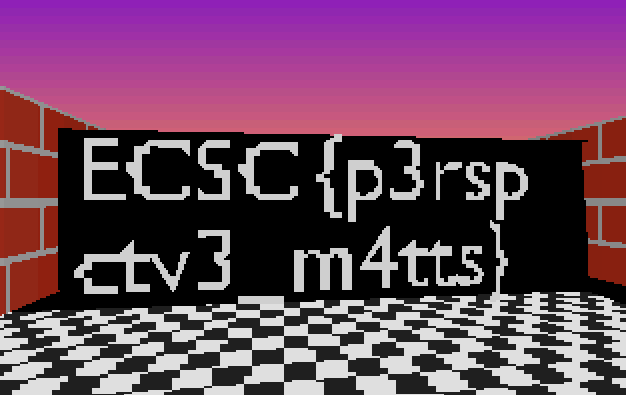

# Solution

Just patch out wall collision and look in the inside of the map.

```
printf '\x31\xC0\xC3\xC3' | dd of=real3dmaze.img bs=1 seek=$((0x11DF)) conv=notrunc status=none
printf '\x31\xC0\xC3\xC3' | dd of=real3dmaze.img bs=1 seek=$((0x11A0)) conv=notrunc status=none
```

