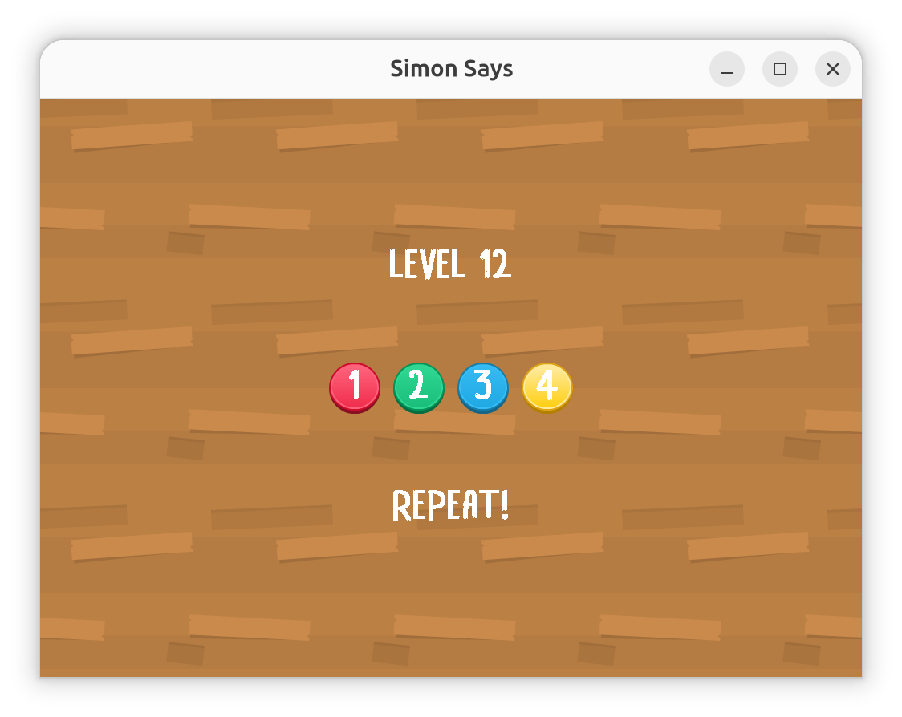

## Simon Says
This challenge implements the game Simon Says.



Remember the notes that are played by the game and repeat them to advance to the next level. If you reach level 1000, the flag is displayed on the screen. The game is played using the keyboard.

## Network Setup
After activating a session on the jeopardy platform, use the following command to forward TCP traffic to a TLS server:

```bash
socat tcp-listen:5000,fork,reuseaddr,bind=localhost openssl:<host>:<port>
```

For example:

```bash
socat tcp-listen:5000,fork,reuseaddr,bind=localhost \
    openssl:jg87rqxmtjer5egtyh2gf4ydqm-main-5000-simon-says.challenge.ecsc2026.de:443
```

You can then connect the game to the server as follows:

```bash
./main 127.0.0.1 5000
```

## Dependencies
The game was made using SDL2. The following packages may need to be installed before the game can be run:

```bash
sudo apt install libsdl2-2.0-0 libsdl2-ttf-2.0-0 libsdl2-mixer-2.0-0 libbearssl0
```

## Credits
The assets for this game were acquired from the following sources:
* https://kenney.nl
* https://freesound.org/people/Sadiquecat
* https://github.com/ggbotnet/fonts-cc0
